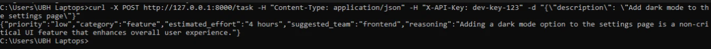

# Agent Task API

An AI-powered task triage agent that analyzes task descriptions (bug reports, feature requests, support tickets) and returns structured recommendations — priority, category, effort estimate, and suggested team.

Built with FastAPI, Google Gemini, and Docker. Designed as a foundation for agentic AI workflows with secure API access, structured outputs, and observability.

---

## Demo




---

## Overview

Task triage is a repetitive but important job. Someone has to read each incoming request, decide how urgent it is, categorize it, and route it to the right team. This project automates that first pass with an AI agent.

Send a task description. Get back a structured analysis. No human needed until the work actually starts.

### Example

**Request:**
```json
{
  "description": "Users can't log in after the latest update"
}
```

**Response:**
```json
{
  "priority": "high",
  "category": "bug",
  "estimated_effort": "4 hours",
  "suggested_team": "backend",
  "reasoning": "A login failure preventing user access is a critical production bug requiring immediate attention."
}
```

---

## Architecture

The system is built from four clear components:

| Component | File | Responsibility |
|-----------|------|----------------|
| **API Layer** | `app/main.py` | Receives HTTP requests, routes them, returns responses |
| **Authentication** | `app/auth.py` | Validates API keys before processing requests |
| **Agent** | `app/agent.py` | Sends tasks to Gemini, enforces structured output |
| **Configuration** | `.env` | Stores secrets (Gemini API key, valid API keys) |

**Supporting files:**
- `app/models.py` — Pydantic schemas defining input/output shapes
- `app/logging_config.py` — Structured JSON logging

**Request flow:**
```
Client → FastAPI → Auth check → Agent → Gemini → Structured JSON → Client
```

---

## Tech Stack

| Technology | Purpose |
|------------|---------|
| **Python 3.12** | Runtime |
| **FastAPI** | HTTP API framework |
| **Google Gemini** | Large language model |
| **Pydantic** | Input/output validation |
| **Docker** | Containerized deployment |
| **Uvicorn** | ASGI server |

---

## API Reference

### `GET /health`

Health check endpoint. No authentication required.

**Response:**
```json
{"status": "ok"}
```

### `POST /task`

Analyze a task description. Requires an API key in the `X-API-Key` header.

**Headers:**
```
Content-Type: application/json
X-API-Key: your-api-key
```

**Body:**
```json
{
  "description": "string (minimum 5 characters)"
}
```

**Success Response (200):**
```json
{
  "priority": "low | medium | high",
  "category": "bug | feature | support",
  "estimated_effort": "string",
  "suggested_team": "string",
  "reasoning": "string"
}
```

**Error Responses:**
- `401 Unauthorized` — Missing or invalid API key
- `422 Unprocessable Entity` — Invalid request body
- `500 Internal Server Error` — Agent processing failed

---

## Getting Started

### Prerequisites

- [Docker Desktop](https://www.docker.com/products/docker-desktop/) installed and running
- A Gemini API key from [Google AI Studio](https://aistudio.google.com/apikey)

### Installation

1. **Clone the repository:**
   ```bash
   git clone https://github.com/thetubamaryam/agent-task-api.git
   cd agent-task-api
   ```

2. **Create a `.env` file** in the project root:
   ```
   GEMINI_API_KEY=your-gemini-api-key
   API_KEYS=dev-key-123
   ```

3. **Build and run with Docker:**
   ```bash
   docker-compose build
   docker-compose up
   ```

4. **Verify the server is running:**
   ```bash
   curl http://127.0.0.1:8000/health
   ```
   Should return `{"status":"ok"}`.

### Running Without Docker

If you prefer to run locally without Docker:

```bash
python -m pip install -r requirements.txt
python -m uvicorn app.main:app --host 0.0.0.0 --port 8000
```

---

## Usage

### Test the agent

```bash
curl -X POST http://127.0.0.1:8000/task \
  -H "Content-Type: application/json" \
  -H "X-API-Key: dev-key-123" \
  -d "{\"description\": \"Users cant log in after latest update\"}"
```

### Try different task types

```bash
# Feature request
curl -X POST http://127.0.0.1:8000/task \
  -H "Content-Type: application/json" \
  -H "X-API-Key: dev-key-123" \
  -d "{\"description\": \"Add dark mode to settings page\"}"

# Support ticket
curl -X POST http://127.0.0.1:8000/task \
  -H "Content-Type: application/json" \
  -H "X-API-Key: dev-key-123" \
  -d "{\"description\": \"Customer cannot reset password\"}"
```

### Test authentication

```bash
# This should return 401 Unauthorized
curl -X POST http://127.0.0.1:8000/task \
  -H "Content-Type: application/json" \
  -H "X-API-Key: wrong-key" \
  -d "{\"description\": \"test\"}"
```

---

## Features

- **Secure API access** — API key authentication on every request
- **Structured output** — Pydantic schemas enforce consistent JSON responses
- **Observability** — Structured JSON logs for every request
- **Error handling** — Clean failure responses instead of stack traces
- **Containerized** — Reproducible builds with Docker
- **Environment-based configuration** — No secrets in code

---

## Lessons Learned

Building this project surfaced several real engineering issues:

1. **Model names change.** Gemini retired `gemini-2.0-flash` and `gemini-3.1-flash` mid-development. Debugged using the API's error messages to identify the current model (`gemini-3.5-flash`).

2. **Secrets must stay out of images.** Learned to use `.dockerignore` to keep `.env` out of the Docker image, and inject secrets at runtime via `docker-compose.yml`.

3. **Logging is not optional.** Structured JSON logs made it possible to trace exactly where requests were failing without adding print statements.

4. **Error boundaries matter.** Wrapping the Gemini call in try/except means external failures don't crash the API — users get a clean error message instead.

---

## Author

**Tuba Maryam**
GitHub: [@thetubamaryam](https://github.com/thetubamaryam)
```

---
